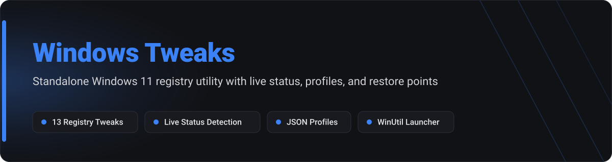
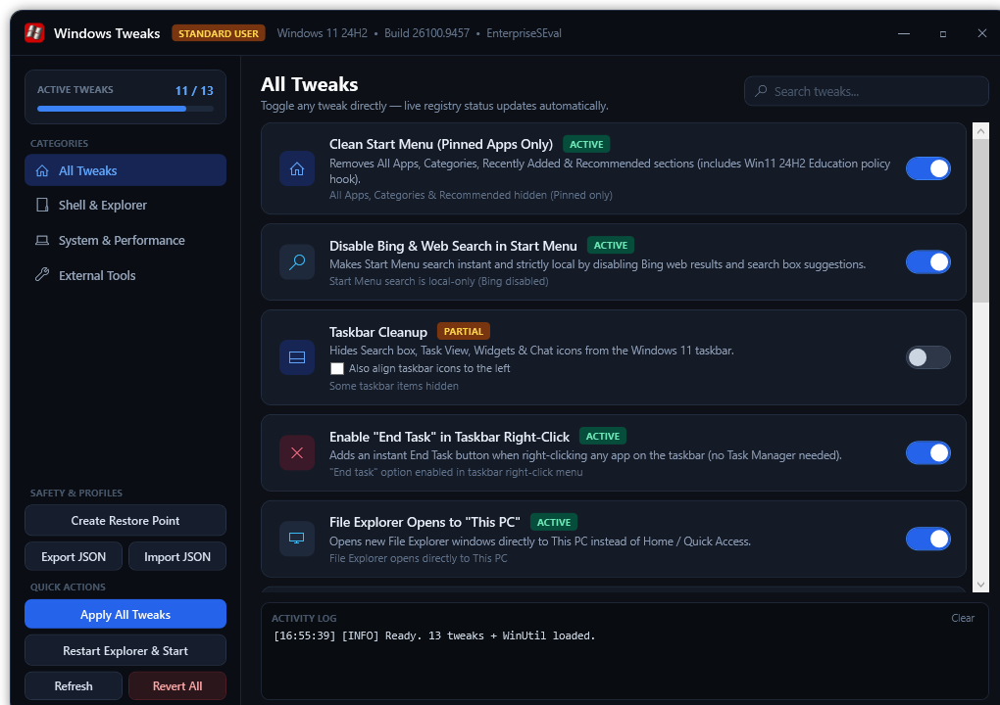
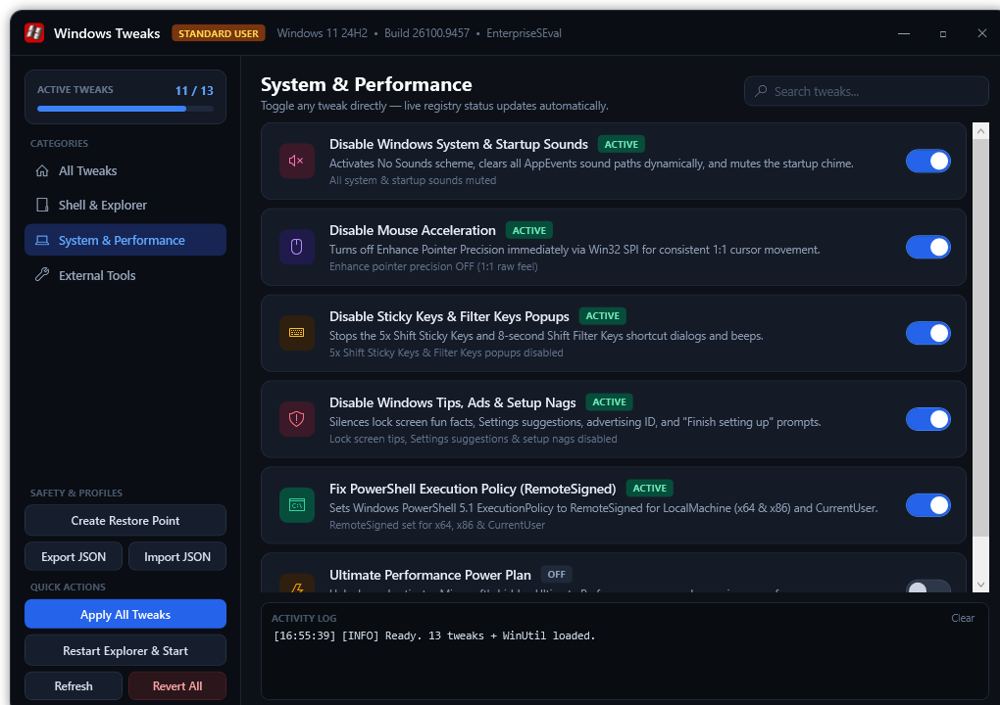
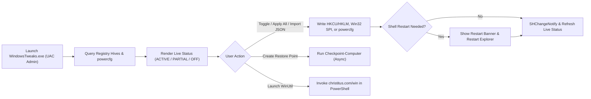

<div align="center">


# Windows Tweaks

Standalone Windows 11 desktop utility and registry script collection for configuring Shell, Explorer, audio, input, and power settings with live status detection.


<br /><br />



<br /><br />

[Features](#features) • [Screenshots](#screenshots) • [How it works](#how-it-works) • [Installation](#installation) • [Usage](#usage) • [Configuration](#configuration) • [Troubleshooting](#troubleshooting)

</div>

## About

**Windows Tweaks** is a single-file C# / WPF desktop application (`src/WindowsTweaks.cs`) compiled with the built-in .NET Framework 4.x compiler (`csc.exe`) and zero third-party packages. It embeds an administrator UAC manifest (`src/app.manifest`) to read and write both `HKCU` and `HKLM` 64-bit/32-bit registry hives, invoke Win32 `SystemParametersInfo` / `SHChangeNotify`, and configure power plans via `powercfg.exe`. All 13 built-in tweaks operate strictly offline and can be reverted individually or in bulk; only the optional Chris Titus Tech WinUtil launcher fetches a remote PowerShell script over TLS 1.2. The repository also ships standalone `.reg` files and `WinUtil-Advanced.bat` for applying common tweaks without opening the GUI.

## Features

- **Live Registry & Power Plan Detection** — Queries the actual registry keys and active `powercfg` scheme on startup and after every action, displaying `ACTIVE`, `PARTIAL`, or `OFF` status badges plus an active tweak progress counter (`X / 13`).
- **7 Shell & Explorer Tweaks** — Clean Start Menu (Pinned Apps only, including the Windows 11 24H2 `Education\IsEducationEnvironment` policy hook), disable Bing & web search in Start, Taskbar cleanup (with optional left alignment), enable right-click **End task** in the taskbar, open File Explorer to **This PC**, show hidden files & extensions (with optional protected OS files), and restore the classic Windows 10 right-click context menu.
- **6 System & Performance Tweaks** — Mute all Windows system & startup sounds dynamically across `AppEvents\Schemes\Apps`, disable mouse acceleration (Enhance Pointer Precision) immediately via Win32 `SPI_SETMOUSE`, disable 5x Shift Sticky Keys and Filter Keys popups, turn off Windows tips/ads/setup nags (`ContentDeliveryManager`, `ScoobeSystemSettingEnabled`, `AdvertisingInfo`), set PowerShell 5.1 `ExecutionPolicy` to `RemoteSigned` (x64, x86, and CurrentUser), and unlock/activate the **Ultimate Performance** power plan.
- **Category Filtering & Live Search** — Filter cards by `All Tweaks`, `Shell & Explorer`, `System & Performance`, or `External Tools`, or narrow by keyword in the search box.
- **System Restore Point & JSON Profiles** — Create a Windows System Restore Point (`WindowsTweaks Backup`) asynchronously via `Checkpoint-Computer`, and export or import your tweak configuration as a `.json` profile.
- **One-Click Explorer Restart & Bulk Actions** — Apply All, Revert All (with confirmation prompt), Refresh live status, or restart `StartMenuExperienceHost` and `explorer.exe` directly from the sidebar or the contextual restart banner.
- **Integrated WinUtil Launcher** — Launch Chris Titus Tech WinUtil in an elevated PowerShell window with `Advanced (Headless)`, `Standard (Headless)`, `Minimal (Headless)`, or `Open WinUtil GUI` modes.
- **Standalone Scripts Included** — Six `.reg` files and `WinUtil-Advanced.bat` in the repository root for scriptable or manual use outside the GUI.

## Screenshots

<p align="center">
  
  <br />
  <em>All Tweaks view with live ACTIVE / PARTIAL status badges, sidebar category filters, quick actions, and activity log.</em>
</p>

<p align="center">
  
  <br />
  <em>System &amp; Performance category showing audio, mouse acceleration, Sticky Keys, tips/ads, PowerShell policy, and power plan controls.</em>
</p>

## How it works



## Installation

### Option 1: Run the Pre-Built Executable
1. Clone or download this repository.
2. Double-click `WindowsTweaks.exe` and accept the Administrator UAC prompt.
   - Requires Windows 11 with the built-in .NET Framework 4.x runtime (no extra installation needed).

### Option 2: Build from Source
Run the included PowerShell build script from the repository root:

```powershell
.\src\build.ps1
```

`src/build.ps1` invokes `C:\Windows\Microsoft.NET\Framework64\v4.0.30319\csc.exe` with `/target:winexe`, embeds `Windows Tweaks.ico` and `src/app.manifest`, and outputs `WindowsTweaks.exe` in the repository root.

### Option 3: Standalone `.reg` Files & Batch Script
You can apply individual tweaks without running `WindowsTweaks.exe` by double-clicking any of the root `.reg` files or running `WinUtil-Advanced.bat` (which self-elevates via UAC and runs the Chris Titus WinUtil `Advanced` preset).

## Usage

### GUI Workflow
1. **(Optional) Back up first:** Click **Create Restore Point** in the left sidebar before making bulk changes.
2. **Toggle individual tweaks:** Click any toggle switch to apply or revert that tweak immediately. Sub-options (**Also align taskbar icons to the left** and **Also show protected OS files**) can be checked before or after enabling their parent tweak.
3. **Restart Explorer when prompted:** For Start Menu, Web Search, Context Menu, or Hidden Files changes, click **Restart Explorer Now** in the amber banner (or **Restart Explorer & Start** in the sidebar).
4. **Bulk operations:** Use **Apply All Tweaks** to enable all 13 built-in tweaks, **Revert All** to restore Windows defaults, or **Refresh** to re-read registry state.

### Built-In Tweaks & Standalone Equivalents

| Tweak | Category | Registry / Mechanism | Standalone File |
| :--- | :--- | :--- | :--- |
| Clean Start Menu (Pinned Apps Only) | Shell & Explorer | `HKCU`/`HKLM` `Policies\Explorer`, `PolicyManager\current\device\Start` & `Education`, `Explorer\Advanced` | `Disable-StartMenu-Categories.reg` |
| Disable Bing & Web Search in Start Menu | Shell & Explorer | `DisableSearchBoxSuggestions` (`HKCU`/`HKLM`), `BingSearchEnabled=0` | — |
| Taskbar Cleanup (+ Left Align) | Shell & Explorer | `SearchboxTaskbarMode`, `ShowTaskViewButton`, `TaskbarDa`, `TaskbarMn`, `TaskbarAl` | — |
| Enable "End Task" in Taskbar Right-Click | Shell & Explorer | `Explorer\Advanced\TaskbarDeveloperSettings\TaskbarEndTask=1` | — |
| File Explorer Opens to "This PC" | Shell & Explorer | `Explorer\Advanced\LaunchTo=1` | `Explorer-Open-ThisPC.reg` |
| Show Hidden Files & Extensions (+ SuperHidden) | Shell & Explorer | `Hidden=1`, `HideFileExt=0`, `ShowSuperHidden` | `Show-Hidden-Files-And-Extensions.reg` |
| Restore Classic Right-Click Context Menu | Shell & Explorer | `HKCU\Software\Classes\CLSID\{86ca1aa0-34aa-4e8b-a509-50c905bae2a2}\InprocServer32` | `restore-classic-context-menu.reg` |
| Disable Windows System & Startup Sounds | System & Performance | `AppEvents\Schemes=.None`, clears `.Current` sound paths, `DisableStartupSound=1` | `Disable-Windows-Sounds.reg` |
| Disable Mouse Acceleration | System & Performance | `Control Panel\Mouse` + Win32 `SystemParametersInfo(SPI_SETMOUSE)` | — |
| Disable Sticky Keys & Filter Keys Popups | System & Performance | `Accessibility\StickyKeys`, `Keyboard Response`, `ToggleKeys` flags | — |
| Disable Windows Tips, Ads & Setup Nags | System & Performance | `ContentDeliveryManager`, `UserProfileEngagement`, `AdvertisingInfo` | — |
| Fix PowerShell Execution Policy | System & Performance | `ExecutionPolicy=RemoteSigned` (`HKLM` 64-bit/32-bit & `HKCU`) | `fix-powershell-execution-policy.reg` |
| Ultimate Performance Power Plan | System & Performance | `powercfg.exe -duplicatescheme e9a42b02-d5df-448d-aa00-03f14749eb61` + `/setactive` | — |
| Chris Titus Tech WinUtil | External Tools | Elevated PowerShell calling `https://christitus.com/win` | `WinUtil-Advanced.bat` |

## Configuration

Use **Export JSON** and **Import JSON** in the sidebar to save or replicate your exact tweak selection across machines. Importing a profile applies every `true` flag and reverts every `false` flag.

Default filename: `WindowsTweaks-Profile.json`

```json
{
  "Version": 1,
  "ExportedAt": "2026-11-20 16:55:00",
  "CleanStartMenu": true,
  "DisableWebSearch": true,
  "TaskbarCleanup": true,
  "AlignTaskbarLeft": false,
  "TaskbarEndTask": true,
  "ExplorerThisPc": true,
  "ShowHiddenFiles": true,
  "ShowSuperHidden": false,
  "ClassicContextMenu": true,
  "DisableSounds": true,
  "DisableMouseAccel": true,
  "DisableStickyKeys": true,
  "DisableTipsAndAds": true,
  "PowerShellExecPolicy": true,
  "UltimatePowerPlan": false
}
```

## Troubleshooting

- **System Restore Point creation fails:** Windows limits `Checkpoint-Computer` to one restore point every 24 hours by default and requires System Protection to be enabled on the system drive. Check the Activity Log for the exact PowerShell error message.
- **Start Menu still shows Recommended after toggling:** Click **Restart Explorer & Start** in the sidebar. On Windows 11 24H2, signing out and back in (or rebooting once) may be required for `PolicyManager\current\device\Education` changes to take full effect.
- **System sounds still play briefly after muting:** Windows caches some sound events per session. Sign out and back in for all muted `AppEvents` entries to apply completely.
- **`src/build.ps1` cannot find `csc.exe`:** Ensure the .NET Framework 4.x 64-bit runtime is present at `C:\Windows\Microsoft.NET\Framework64\v4.0.30319\csc.exe` and `Windows Tweaks.ico` exists in the repository root.
- **WinUtil fails to launch:** The WinUtil launcher downloads `https://christitus.com/win` over HTTPS (TLS 1.2) and requires an active internet connection and administrator privileges.
